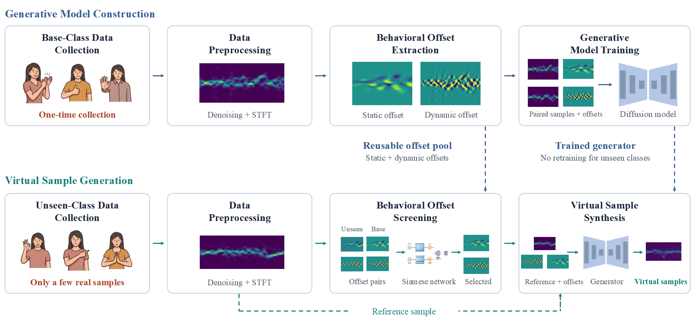
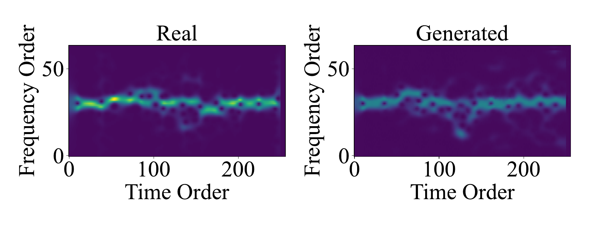
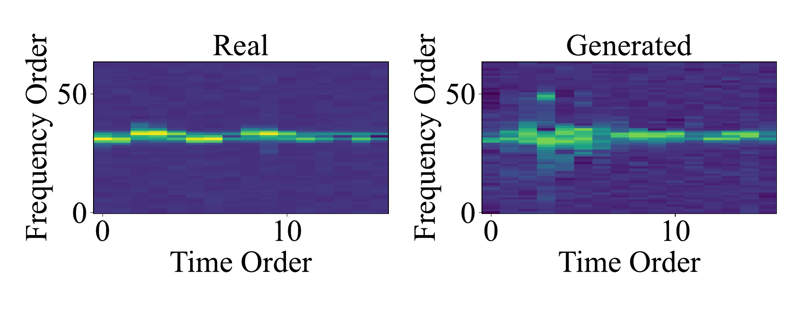
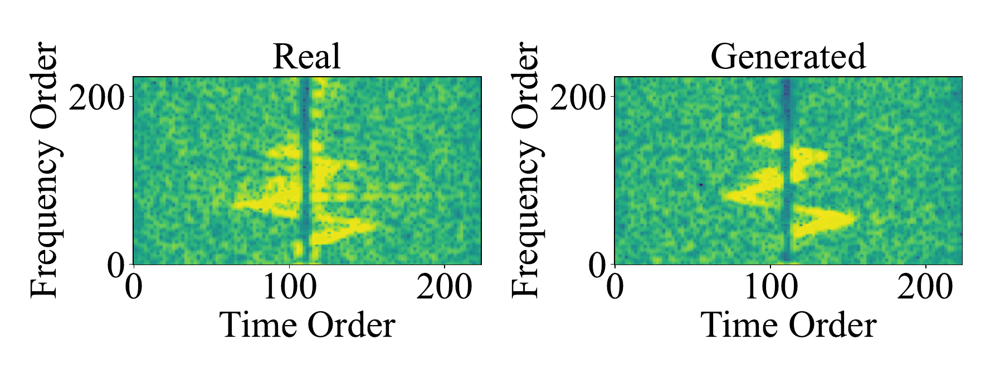

# SenseGen

SenseGen generates synthetic sensing samples for wireless human-computer interaction (HCI). Given a small set of real examples from a gesture or activity class, it uses behavioral variations learned from base classes to produce additional samples for downstream classifier training.

The project supports WiFi, millimeter-wave (mmWave), and ultrasound data through a shared workflow. It provides scripts for preparing `.npy` arrays, extracting and screening behavioral offsets, training a diffusion model, generating samples, and evaluating their use in a few-shot CNN classifier. The `demo/` directory includes a small set of examples and a checkpoint for each modality.

## How It Works

SenseGen separates its workflow into two stages:

1. **Model construction:** Prepare samples from base classes, extract static and dynamic offsets between pairs of samples, and train the offset-conditioned diffusion model.
2. **Sample generation:** Prepare a few real samples from an unseen class, screen the reusable base-class offsets, and use selected offsets to generate additional samples. A CNN can then be trained with real samples and optionally the generated samples.

Static offsets capture slowly varying differences between paired signals; dynamic offsets capture the remaining faster variations. The trained generator reuses these patterns for unseen classes without class-specific retraining.

## Workflow



The workflow figure summarizes one-time model construction from base classes and few-shot generation for unseen classes.

## Representative Generated Samples

The following examples compare real and generated samples across three sensing modalities. Each image shows a real sample on the left and a generated sample on the right.

| WiFi | mmWave | Ultrasound |
|:--:|:--:|:--:|
|  |  |  |

## Evaluation Results

With three real support samples per unseen class, the reported downstream recognition results are:

| Modality | 3-shot recognition accuracy | Improvement over real-only baseline |
|:----------:|:----------------------------:|:------------------------------------:|
| WiFi | 91.3% | +8.4 percentage points |
| mmWave | 85.8% | +15.1 percentage points |
| Ultrasound | 81.6% | +19.4 percentage points |

The evaluation used 20 generated samples per support sample, giving 60 virtual samples per unseen class. Results were averaged over ten trials with randomly selected support samples and across subjects. These are published benchmark results; the packaged demo exercises generation and does not reproduce the benchmark.

## System Overview

SenseGen treats each sensing sample as a two-dimensional representation: a CSI-derived spectrogram, a processed mmWave heatmap, or an ultrasound spectrogram. The modules share a directory convention and `.npy` sample format, with modality-specific shapes.

At the implementation level, the pipeline passes data through a small set of reusable artifacts: preprocessed samples, base-class offset pools, few-shot unseen split files, Siamese-filtered offset indexes, diffusion checkpoints, generated samples, and CNN evaluation outputs. Each artifact is stored on disk with explicit paths, so stages can be inspected or rerun independently.

## Module Overview

### Preprocessing

`model code/preprocess.py` accepts modality-specific `.npy` arrays and prepares shapes and numeric formats for the later stages. WiFi and ultrasound inputs must already be spectrograms; this script does not perform acquisition, raw-signal denoising, or STFT. These upstream preparation steps must be completed before using the script.

WiFi and ultrasound arrays are zero-padded to the target shape. mmWave arrays undergo averaging, frame removal, a log transform, and normalization. The script exposes a unified `--signal_type` argument; the input and output shapes are listed under **Expected Shapes**.

### Offset Extraction

`model code/extract_offset.py` builds static and dynamic offset pools from within-class sample pairs. These offsets are the main bridge between observed base-class motion patterns and unseen-class generation. The same script also creates and reuses few-shot split files, so the support samples used for unseen-query offsets can stay aligned with later generation and evaluation.

The offset directory is organized by offset type, source, and class. This makes it possible to filter offsets per unseen class without copying large arrays when JSON indexes are used.

For each pair, the implementation computes an element-wise sample difference, extracts its smooth static component with a Savitzky-Golay filter, and uses the residual as the dynamic component.

### Siamese Offset Filtering

The Siamese module contains:

| File | Role |
|------|------|
| `model code/siamese/siamese_network.py` | Shared embedding network for offset similarity |
| `model code/siamese/train_siamese.py` | Training script for offset-pair similarity learning |
| `model code/siamese/filter_offsets.py` | Selection script for class-specific reusable offsets |

The filtering stage compares base-class offsets with few-shot unseen-query offsets. With `--index_only`, it writes compact JSON indexes that point to selected base offsets instead of duplicating `.npy` files. This keeps full experiments manageable when offset pools are large.

### Diffusion Generation

`model code/diffusion/` contains the default generator used by the project. Its defaults enable residual offset gating, bottleneck cross-attention, and dynamic-offset modulation of the timestep embedding. The training script learns from base-class samples and base offsets; the sampling script uses selected offsets with unseen-class support samples.

Key files:

| File | Role |
|------|------|
| `config.py` | Shared defaults and modality-specific settings |
| `dataset.py` | Dataset loading for samples and offsets |
| `diffusion.py` | Diffusion process and sampling utilities |
| `unet.py` | Conditional U-Net backbone |
| `train.py` | Training entry point |
| `sample.py` | Unseen-class generation entry point |

The sampling code uses DDPM sampling. A positive `--sdedit_t` enables SDEdit-style generation anchored to a real support sample, as in the commands below. Omitting it starts sampling from noise.

### CNN Evaluation

`cnn_classifier/` provides the downstream few-shot evaluation protocol. `cnn_eval_unseen.py` trains and evaluates a small CNN on real few-shot unseen samples, then optionally augments the support set with generated samples. This stage is not part of the generator itself; it is included to provide a consistent way to check whether generated samples are useful for classifier training.

For multi-trial evaluation, omitting `--seed` lets each trial use an automatically incremented seed. Passing `--seed` fixes the seed across all trials. Saved split files take precedence over random support selection, so changing the trial seed does not resample a saved support/evaluation split.

## Repository Layout

```text
SenseGen/
|-- README.md
|-- requirements.txt
|-- assets/
|   |-- workflow.png
|   |-- gen_wifi.png
|   |-- gen_mmWave.png
|   +-- gen_ultrasound.png
|-- demo/
|   |-- WiFi/
|   |-- mmWave/
|   +-- ultrasound/
|-- scripts/
|   |-- run_pipeline_wifi.sh
|   |-- run_pipeline_mmwave.sh
|   |-- run_pipeline_ultrasound.sh
|   |-- run_pipeline_wifi.ps1
|   |-- run_pipeline_mmwave.ps1
|   +-- run_pipeline_ultrasound.ps1
|-- model code/
|   |-- preprocess.py
|   |-- extract_offset.py
|   |-- see_npy.py
|   |-- diffusion/
|   |   |-- config.py
|   |   |-- dataset.py
|   |   |-- diffusion.py
|   |   |-- sample.py
|   |   |-- train.py
|   |   +-- unet.py
|   +-- siamese/
|       |-- filter_offsets.py
|       |-- siamese_network.py
|       +-- train_siamese.py
+-- cnn_classifier/
    |-- cnn_models.py
    |-- cnn_classify.py
    +-- cnn_eval_unseen.py
```

Note that `model code` contains a space, so quote paths that point into it.

## Installation

Use Python 3.9 or newer with compatible builds of the packages in `requirements.txt`. Run the following commands from the repository root.

Linux/macOS or a Bash environment:

```bash
python -m venv .venv
source .venv/bin/activate
python -m pip install -r requirements.txt
```

Windows PowerShell:

```powershell
python -m venv .venv
.\.venv\Scripts\Activate.ps1
python -m pip install -r requirements.txt
```

For CUDA, install a compatible CUDA-enabled PyTorch build in the environment. Use `--device cpu` for CPU execution; diffusion sampling on CPU can be slow. The requirements specify minimum versions rather than a pinned environment, so record the Python and package versions used for experiments.

The multi-line demo and manual commands below use Bash continuation syntax (`\`). In PowerShell, put each command on one line or replace the continuation characters with backticks. The `.ps1` runners shown below already use PowerShell syntax.

## Packaged Demo

The `demo/` directory contains one compact generation example per modality: a trained diffusion checkpoint, a small base offset pool, and a small unseen sample set. It is intended to verify the generation path and file conventions, not to report classification accuracy or reproduce full benchmark numbers.

The packaged checkpoints are lightweight demo artifacts. The commands below use `--sdedit_t 100` for a shorter sampling run. Each modality's demo contains one base class and one unseen class; CNN unseen evaluation requires at least two unseen classes and additional real data.

Use checkpoints from trusted sources: the current checkpoint loader deserializes Python objects as well as model weights.

Current demo contents:

| Modality | Checkpoint | Offset pairs |
|----------|------------|--------------|
| WiFi | `demo/WiFi/checkpoints_wifi/model_final.pt` | 50 |
| mmWave | `demo/mmWave/checkpoints_mmwave/model_final.pt` | 50 |
| Ultrasound | `demo/ultrasound/checkpoints_ultrasound/model_final.pt` | 50 |

Example generation commands:

```bash
python "model code/diffusion/sample.py" \
    --checkpoint "demo/WiFi/checkpoints_wifi/model_final.pt" \
    --signal_type wifi \
    --data_dir "demo/WiFi/WiFi data_pad/unseen" \
    --base_offset_dir "demo/WiFi/WiFi_offsets" \
    --source volunteer_0 --class_name class_18 \
    --num_shots 1 --samples_per_shot 2 --sample_batch_size 2 \
    --sdedit_t 100 \
    --output_dir "generated_demo/WiFi" \
    --device cuda --seed 42

python "model code/diffusion/sample.py" \
    --checkpoint "demo/mmWave/checkpoints_mmwave/model_final.pt" \
    --signal_type mmwave \
    --data_dir "demo/mmWave/mmWave_data_proc/unseen" \
    --base_offset_dir "demo/mmWave/mmWave_offsets" \
    --source volunteer_1 --class_name class_12 \
    --num_shots 1 --samples_per_shot 2 --sample_batch_size 2 \
    --sdedit_t 100 \
    --output_dir "generated_demo/mmWave" \
    --device cuda --seed 42

python "model code/diffusion/sample.py" \
    --checkpoint "demo/ultrasound/checkpoints_ultrasound/model_final.pt" \
    --signal_type ultrasound \
    --data_dir "demo/ultrasound/ultrasound data_proc/unseen" \
    --base_offset_dir "demo/ultrasound/ultrasound_offsets" \
    --source volunteer_5 --class_name F \
    --num_shots 1 --samples_per_shot 2 --sample_batch_size 2 \
    --sdedit_t 100 \
    --output_dir "generated_demo/ultrasound" \
    --device cuda --seed 42
```

## Expected Shapes

| Modality | Input to `preprocess.py` | Output shape | Processing |
|----------|--------------------------|--------------|------------|
| WiFi | `(61, 250)` spectrogram | `(64, 256)` | Zero-padding |
| mmWave | `(1, 17, 256, 128)` array | `(16, 128)` | Averaging, frame removal, log transform, z-score normalization |
| Ultrasound | `(224, 224)` spectrogram | `(256, 256)` | Zero-padding; input normalization is preserved |

The demo data is already preprocessed and can be passed directly to `sample.py`. Do not run it through `preprocess.py` again. For mmWave experiments, use `--splits base unseen --shared_stats` so unseen data is normalized with statistics computed from the base split.

## Supported Modalities

### WiFi CSI

WiFi samples are handled as CSI-derived spectrograms. The default shape is compact enough for efficient diffusion training while preserving the time-frequency structure used by the offset extractor. WiFi examples use `volunteer_0` and class names such as `class_00`.

### mmWave

mmWave samples are reduced to two-dimensional heatmaps by the preprocessing script. The mmWave workflow follows the same offset, diffusion, and CNN evaluation stages as WiFi, with modality-specific defaults for source names, batch sizes, and paths.

### Ultrasound

Ultrasound samples are handled as higher-resolution spectrograms. Because the default shape is larger, ultrasound diffusion training usually needs a smaller batch size than WiFi or mmWave. Ultrasound examples use letter-style class names such as `A` and `F`.

## Data Availability

The repository includes compact examples under `demo/`; it does not include the complete training and evaluation datasets or the full preprocessing chain from raw sensor recordings. The full pipeline runners require separately prepared base-class and unseen-class data in the formats below.

To use your own data, organize the prepared arrays as shown below and adjust the source names and class directories in the commands. The reported evaluation used a collected WiFi gesture dataset, mmWave data from **XRF55**, and an ultrasound gesture dataset used in **PreGesNet**. The full datasets are not included in this repository.

## Data Layout

The pipeline expects samples stored as `.npy` files under `base` and `unseen` splits. Full-scale generated files and checkpoints are ignored by Git; the compact artifacts under `demo/` are the only packaged exception.

### WiFi

```text
WiFi data/
|-- base/
|   +-- volunteer_0/
|       +-- class_00/
|           +-- sample_00.npy
+-- unseen/
    +-- volunteer_0/
        +-- class_15/
            +-- sample_00.npy
```

Legacy `channel_X` directories are still readable for compatibility, but the recommended convention is `volunteer_X`.

### mmWave

```text
mmWave_data/
|-- base/
|   +-- volunteer_1/
|       +-- class_00/
|           +-- sample_00.npy
+-- unseen/
    +-- volunteer_1/
        +-- class_15/
            +-- sample_00.npy
```

### Ultrasound

```text
ultrasound data_split/
|-- base/
|   +-- volunteer_5/
|       +-- A/
|           +-- sample_00.npy
+-- unseen/
    +-- volunteer_5/
        +-- F/
            +-- sample_00.npy
```

## Full Pipeline Runners

Bash runners in `scripts/` encode the default end-to-end workflows. Windows PowerShell equivalents are also provided in the same directory. They are intended as reproducible starting points and can be edited for your dataset paths, class lists, or GPU memory budget.

Run them from the repository root after preparing the full input datasets. They train models as well as generate data, and are not shortcuts for running the compact demo. Check each Python stage's exit status and expected outputs before continuing if a PowerShell runner reports a failure.

```bash
bash ./scripts/run_pipeline_wifi.sh
bash ./scripts/run_pipeline_mmwave.sh
bash ./scripts/run_pipeline_ultrasound.sh
```

The Bash runners accept:

| Parameter | Default | Meaning |
|-----------|---------|---------|
| `--device` | `cuda` | PyTorch device, usually `cuda` or `cpu` |
| `--source` | modality-specific | Volunteer/source directory |
| `--seed` | `42` | Seed for deterministic split creation and model runs |

Example:

```bash
bash ./scripts/run_pipeline_wifi.sh --device cuda --source volunteer_0 --seed 42
```

Windows PowerShell example:

```powershell
.\scripts\run_pipeline_wifi.ps1 -Device cuda -Source volunteer_0 -Seed 42
```

The runners use split directories such as `split_info_wifi`, so offset screening, generation, and evaluation reuse the same support/evaluation split. All current runners use a screening interval of `[0.65, 0.95]`; this differs from the modality-specific intervals used in the reported evaluation:

| Modality | Reported evaluation interval | Current runner interval |
|----------|--------------------------|-------------------------|
| WiFi | `[0.80, 0.99]` | `[0.65, 0.95]` |
| mmWave | `[0.70, 0.95]` | `[0.65, 0.95]` |
| Ultrasound | `[0.60, 0.95]` | `[0.65, 0.95]` |

Choose and record the interval used for your experiment. The manual WiFi example below uses the reported WiFi interval.

## Manual Workflow

The same workflow can be run manually stage by stage. The examples below use WiFi paths. For mmWave or ultrasound, also adapt the preprocessing flags, Savitzky-Golay parameters, screening interval, and batch sizes shown in their runners; changing only the paths and `--signal_type` is insufficient.

### 1. Preprocess

```bash
python "model code/preprocess.py" \
    --signal_type wifi \
    --src "WiFi data" \
    --dst "WiFi data_pad" \
    --volunteers volunteer_0
```

### 2. Extract Base Offsets

```bash
python "model code/extract_offset.py" \
    --signal_type wifi \
    --data_dir "WiFi data_pad/base" \
    --output_dir offsets_WiFi \
    --volunteers volunteer_0 \
    --sg_window 51 --sg_order 3 --sg_axis 1 \
    --seed 42
```

### 3. Extract Few-Shot Unseen Query Offsets

```bash
python "model code/extract_offset.py" \
    --signal_type wifi \
    --data_dir "WiFi data_pad/unseen" \
    --output_dir offsets_unseen_wifi \
    --volunteers volunteer_0 \
    --fewshot_only --num_shots 3 \
    --split_info_dir split_info_wifi \
    --sg_window 51 --sg_order 3 --sg_axis 1 \
    --seed 42 --force_split
```

`--force_split` replaces saved support/evaluation assignments. If those assignments change, rerun offset screening and sample generation before evaluating again.

### 4. Train Siamese Offset Similarity Model

```bash
python "model code/siamese/train_siamese.py" \
    --signal_type wifi \
    --offset_dir offsets_WiFi \
    --output_dir checkpoints_siamese_wifi \
    --source volunteer_0 \
    --epochs 100 --batch_size 128 --lr 1e-3 \
    --device cuda --seed 42
```

### 5. Filter Base Offsets

```bash
python "model code/siamese/filter_offsets.py" \
    --signal_type wifi \
    --siamese_checkpoint checkpoints_siamese_wifi/siamese_best.pt \
    --base_offset_dir offsets_WiFi \
    --unseen_offset_dir offsets_unseen_wifi \
    --output_dir offsets_filtered_wifi \
    --split_info_dir split_info_wifi \
    --source volunteer_0 \
    --threshold 0.8 --upper_threshold 0.99 \
    --per_class --index_only --save_report \
    --batch_size 256 --device cuda
```

`--index_only` writes lightweight JSON indexes instead of copying all selected offset files. The diffusion sampler can read these indexes directly.

### 6. Train Diffusion Model

```bash
python "model code/diffusion/train.py" \
    --signal_type wifi \
    --data_dir "WiFi data_pad/base" \
    --offset_dir offsets_WiFi \
    --volunteers volunteer_0 \
    --use_offset_gate --use_cross_attn \
    --offset_mode both --offset_gate_channels 64 \
    --save_best --max_samples_per_epoch 400 \
    --batch_size 40 \
    --output_dir checkpoints_wifi \
    --device cuda --seed 42
```

The default diffusion implementation uses residual offset gating and bottleneck cross-attention.

### 7. Generate Unseen Samples

```bash
python "model code/diffusion/sample.py" \
    --signal_type wifi \
    --checkpoint checkpoints_wifi/model_final.pt \
    --data_dir "WiFi data_pad/unseen" \
    --base_offset_dir offsets_filtered_wifi \
    --split_info_dir split_info_wifi \
    --source volunteer_0 \
    --per_class_offsets \
    --num_shots 3 --samples_per_shot 20 \
    --sample_batch_size 20 \
    --sdedit_t 500 --cfg_scale 3.0 --offset_scale 1.0 \
    --progress \
    --output_dir generated_WiFi \
    --device cuda --seed 42
```

Full-scale generation can use a larger SDEdit timestep, such as `--sdedit_t 500`, when more variation from the anchor sample is desired.

### 8. Evaluate Unseen Classes

```bash
python "cnn_classifier/cnn_eval_unseen.py" \
    --signal_type wifi \
    --real_dir "WiFi data_pad/unseen" \
    --gen_dir generated_WiFi \
    --split_info_dir split_info_wifi \
    --source volunteer_0 \
    --num_shots 3 --gen_samples 60 \
    --batch_size 64 \
    --early_stop_patience 50 \
    --device cuda \
    --trials 10
```

If `--seed` is omitted in multi-trial CNN unseen evaluation, trials use auto-incremented seeds starting from 42. If `--seed N` is provided, every trial uses the same seed `N`.

With saved split files, `--trials 10` repeats classifier training on the same support/evaluation assignments. To repeat evaluation with independently selected support samples, create a separate split for each trial and rerun unseen-offset extraction, screening, generation, and evaluation for that split. Keep those artifacts in separate directories.

The current CNN evaluation script selects the best epoch and applies early stopping using the reported evaluation set. It does not implement a separate validation/test split. Independent final-test reporting requires adapting the evaluation code to select checkpoints on a validation set first.

## Modality Defaults

| Setting | WiFi | mmWave | Ultrasound |
|---------|------|--------|------------|
| Default source | `volunteer_0` | `volunteer_1` | `volunteer_5` |
| Base data | `WiFi data_pad/base` | `mmWave_data_proc/base` | `ultrasound data_proc/base` |
| Unseen data | `WiFi data_pad/unseen` | `mmWave_data_proc/unseen` | `ultrasound data_proc/unseen` |
| Base offsets | `offsets_WiFi` | `offsets_mmWave` | `offsets_ultrasound` |
| Diffusion checkpoints | `checkpoints_wifi` | `checkpoints_mmWave` | `checkpoints_ultrasound` |
| Generated output | `generated_WiFi` | `generated_mmWave` | `generated_ultrasound` |
| CNN batch size | `64` | `128` | `32` |

Suggested starting batch sizes for diffusion training:

| Modality | Batch size |
|----------|------------|
| WiFi | `40` |
| mmWave | `192` |
| Ultrasound | `8` |

Adjust these values for your GPU memory.

## Main Scripts

| Script | Purpose |
|--------|---------|
| `model code/preprocess.py` | Unified preprocessing for WiFi, mmWave, and ultrasound |
| `model code/extract_offset.py` | Static/dynamic offset extraction and reusable few-shot split creation |
| `model code/siamese/train_siamese.py` | Siamese offset similarity training |
| `model code/siamese/filter_offsets.py` | Offset filtering and JSON index creation |
| `model code/diffusion/train.py` | Default gated diffusion training |
| `model code/diffusion/sample.py` | Offset-conditioned generation |
| `cnn_classifier/cnn_models.py` | Shared CNN model definitions |
| `cnn_classifier/cnn_classify.py` | Optional base-class CNN training |
| `cnn_classifier/cnn_eval_unseen.py` | Few-shot unseen-class evaluation |

## Outputs

Typical generated directories:

```text
offsets_WiFi/
offsets_unseen_wifi/
offsets_filtered_wifi/
checkpoints_siamese_wifi/
checkpoints_wifi/
generated_WiFi/
split_info_wifi/
```

The matching mmWave and ultrasound outputs use the same naming pattern with modality-specific names. These outputs are ignored by `.gitignore`.
